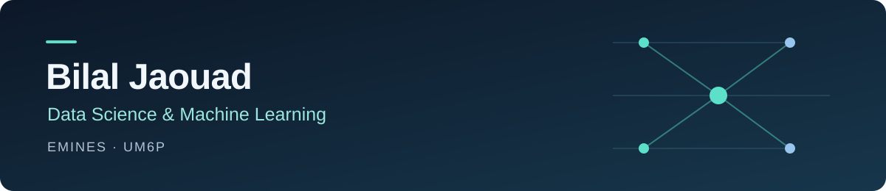

I’m a **Data Science & Machine Learning engineering student at EMINES–UM6P**, Morocco. I work on applied machine learning, language models and the software around them: data preparation, evaluation, APIs and deployment.

During my research internship at **Universiti Malaya**, I worked on clinical LLM evaluation and domain adaptation with QLoRA. I’m interested in building useful ML systems with clear evaluation methods and well-documented limitations.

**Seeking a six-month internship starting March 2027** in Machine Learning, AI Engineering or Data Science.

[LinkedIn](https://www.linkedin.com/in/bilal-j-539b81320) · [Hugging Face](https://huggingface.co/BilalJaouad) · [Explore my repositories](https://github.com/BilalJaouad?tab=repositories)

## Selected projects

### [Clinical-LLM-ACSM](https://github.com/BilalJaouad/clinical-llm-acsm)
**Clinical NLP · LLM evaluation · Parameter-efficient adaptation**

Research on open-source language models for cardiac exercise recommendations based on ACSM guidelines. The work covers document processing, synthetic clinical benchmarks, BioMistral adaptation with QLoRA and a Streamlit prototype with safety checks and optional retrieval.

`Python` `PyTorch` `Hugging Face` `PEFT / QLoRA` `RAG` `Streamlit`

*Research prototype; not clinically validated.*

### [Chess Compagnon](https://github.com/BilalJaouad/chess-compagnon)
**Local AI inference · Browser extension · Human move prediction**

A Chrome and Edge extension that combines Stockfish analysis with Maia 3 predictions at selectable Elo levels. Models run locally through WebAssembly and ONNX Runtime; the interface displays suggested moves, probabilities and board arrows. Includes automated tests and GitHub Actions checks.

`JavaScript` `ONNX Runtime` `WebAssembly` `Manifest V3` `Playwright`

### [WalletProject](https://github.com/BilalJaouad/WalletProject)
**Data analysis · Visualization · Predictive modeling**

A Python personal-finance application for tracking transactions, visualizing income and expenses, and exploring forecasts with linear regression.

`Python` `pandas` `NumPy` `Matplotlib` `scikit-learn`

**Also exploring software security:** [Lab_XSS](https://github.com/BilalJaouad/Lab_XSS), an educational local lab comparing a vulnerable application with defensive mitigations.

## Technical toolkit

| Area | Tools and methods |
| --- | --- |
| Machine learning | Python, scikit-learn, XGBoost, PyTorch, SHAP |
| Language models | Hugging Face, PEFT, QLoRA, RAG, Qdrant |
| Data | SQL, pandas, NumPy, PostgreSQL |
| Applications & delivery | FastAPI, Docker, GCP, Streamlit, Git, GitHub Actions |
| Computer vision | OpenCV, YOLO, temporal CNNs |

## Experience & current work

- **AI Research Intern — Universiti Malaya** · June–August 2026. Clinical document extraction, open-source LLM evaluation, cardiac-domain adaptation and prototype development.
- **Engineering student — EMINES, Mohammed VI Polytechnic University** · Since 2024. Data Science & Machine Learning.
- **Autonomous vehicle project.** Led modeling and camera perception in a four-person sub-team, contributing to a wider thirteen-person vehicle project. Work included line following, obstacle detection and braking.
- **Current exploration: learning to steer in simulation.** Preparing temporal vision models and teacher–student training pipelines for DonkeyCar, with session-based data splits and CPU-oriented deployment.

## Hackathons

- **2nd place — UDSC × Pharma Hack, UM6P** · October 2026. Team lead on clinical-trial site selection using retrieval, scoring and clustering.
- **8th of 28 teams — Hack AI × 1337** · May 2026. AI agents and retrieval-augmented generation.

## Beyond code

Chess, history and philosophy.

**Languages:** Arabic · French · English
